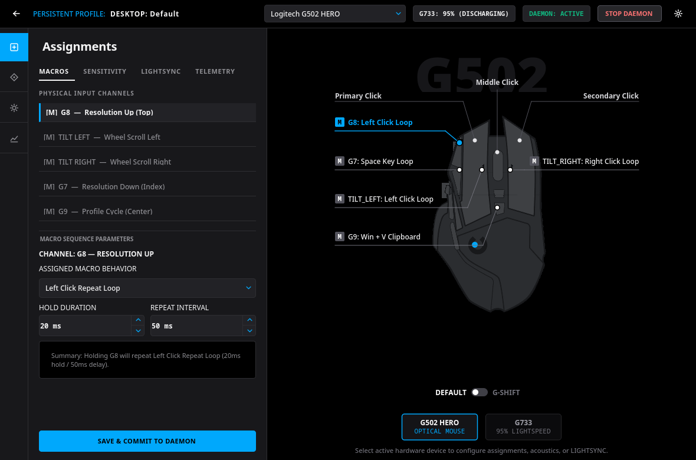
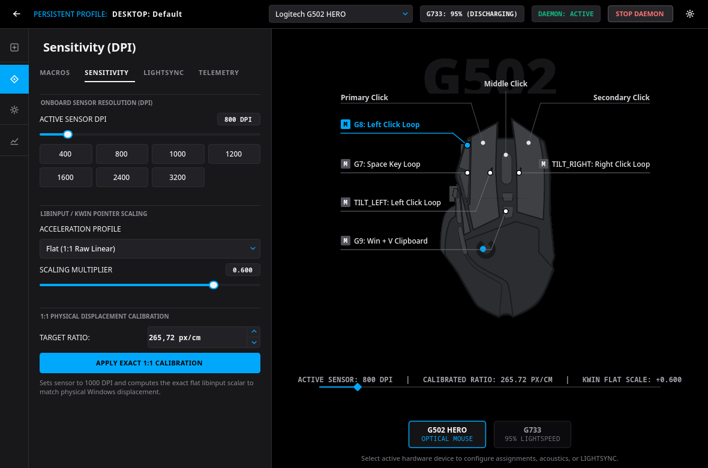
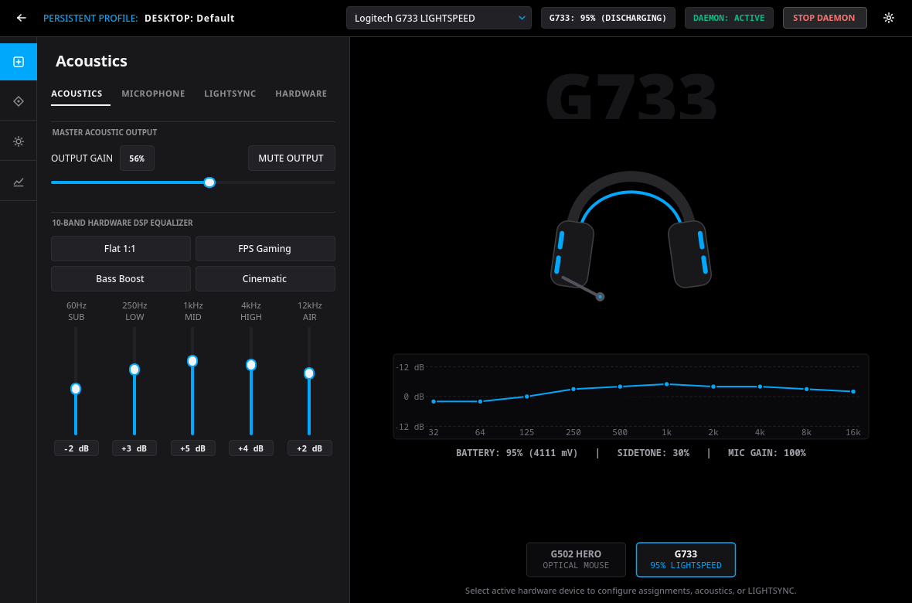
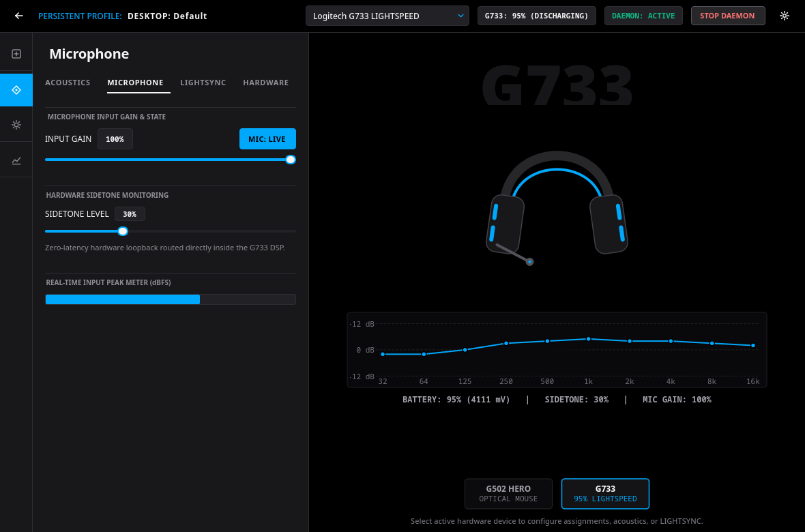
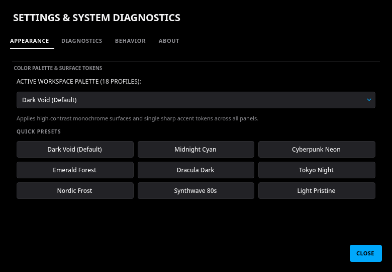

# Logitech G HUB Linux Control Suite (G502 HERO & G733 LIGHTSPEED)

A native Linux hardware configuration and telemetry interface for Logitech G peripherals featuring an authentic Logitech G HUB split-view workspace, low-latency `evdev`/`uinput` macro daemon, exact 1:1 pixel-per-centimeter DPI calibration, PipeWire audio controls, 10-band native HID++ 2.0 hardware DSP equalizer, dual-zone LIGHTSYNC RGB control, and background system tray integration.

> [!NOTE]  
> **Verified Hardware**: Tested and verified on **Logitech G502 HERO Gaming Mouse** (`usb:046d:c332` / `c539`) and **Logitech G733 LIGHTSPEED Wireless Gaming Headset** (`usb:046d:0ab5`).

---

## Interface Previews

### 1. G502 HERO — Assignments & Interactive Callout Stage


### 2. G502 HERO — Sensitivity (DPI) & Exact 1:1 Pixel-per-Centimeter Calibration


### 3. G733 LIGHTSPEED — Acoustics & 10-Band Hardware DSP Equalizer


### 4. G733 LIGHTSPEED — Microphone Gain, Hardware Sidetone & Real-Time Peak Meter


### 5. Settings, High-Contrast Monochrome Palettes & Subsystem Diagnostics


---

## Architecture & Hardware Capabilities

### G502 HERO Gaming Mouse (`evdev` / `uinput` / `libratbagd`)
- **Interactive Hardware Stage**: Pure `#000000` obsidian hardware canvas rendering the dark anodized G502 silhouette with clickable `[M]` callout leader lines (`G8`, `G7`, `G9`, `TILT_LEFT`, `TILT_RIGHT`), live macro binding readouts, and `DEFAULT / G-SHIFT` mode indicator.
- **Macro Sequence Parameters**: Configure Left Click Loop, Right Click Loop, Middle Click Loop, Space Key Loop, Win + V Clipboard History, Custom Keycode Loop, or Disabled with millisecond hold and repeat interval precision.
- **Onboard Sensor DPI**: Live sensor resolution adjustments (`400 – 4000 DPI`, default `800 DPI`) synced across onboard mouse profiles via `ratbagctl`.
- **1:1 Physical Displacement Calibration**: Toggle between **Flat (1:1 Raw Linear)** and **Adaptive (Velocity Curve)** with live KDE KWin DBus scaling, or compute the exact floating-point libinput multiplier for a target **Pixels-per-Centimeter** ratio (e.g. `265.72 px/cm` = ~675 effective DPI).

### G733 LIGHTSPEED Wireless Headset (`HID++ 2.0` / `PipeWire`)
- **Acoustics & 10-Band Hardware Equalizer**: Master output gain slider, output mute toggle, 5-band UI sliders interpolated into the G733's native 10-band HID++ 2.0 DSP Equalizer (`Feature 0x8310`), live frequency response curve on the right hardware stage, and instant presets (*Flat 1:1, FPS Gaming, Bass Boost, Cinematic*).
- **Microphone & Zero-Latency Sidetone**: Input gain slider, `MIC: LIVE / MIC: MUTED` hardware state toggle, zero-latency DSP sidetone loopback (`0–100%`), and auto-recovering real-time dBFS peak meter.
- **Dual-Zone LIGHTSYNC Controller**: Direct HID++ 2.0 addressing for upper and lower G733 front lightstrips with live RGB preview on the hardware stage.
- **Li-Po Battery Telemetry & TTS Readout**: Hysteresis-smoothed 5% G HUB discharge curve (`mV` telemetry) with automatic spoken percentage readout (`spd-say`/`espeak`) when pressing the physical G733 power button.

---

## Quick Start & Verification

1. **Clone the repository**:
   ```bash
   git clone git@github.com:gaxkalik/Logitech-Linux-App.git
   cd Logitech-Linux-App
   ```

2. **Run the installer**:
   ```bash
   chmod +x install.sh
   ./install.sh
   ```

3. **Launch the Control Suite**:
   ```bash
   ./g502_gui.py
   ```

4. **Run the Automated Test Suite (19 Unit & Integration Tests)**:
   ```bash
   python3 -m unittest discover -s tests -p "test_suite.py" -v
   ```
